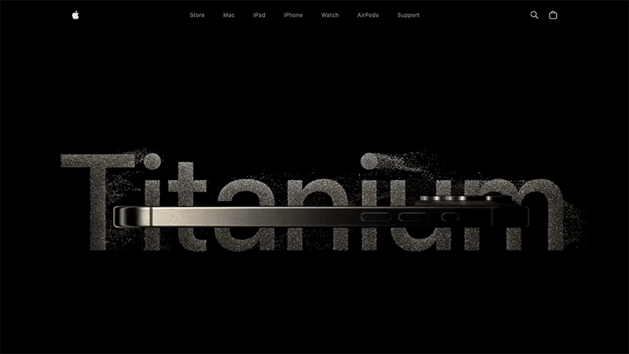

# APPLE IPHONE 15 PRO


A responsive, interactive clone of Apple's **iPhone 15 Pro** product page built with React 19, TypeScript, Tailwind CSS 4, GSAP, and Three.js. It features smooth scroll-triggered animations, an interactive 3D titanium model viewer, and Apple's authentic desktop and mobile navigation patterns.

## Preview



**Live Demo:** [iphone15-pro.netlify.app](https://leozarazaga-iphone15-pro.netlify.app/)

## Features

- **Interactive 3D iPhone Model:** Rotate the iPhone 15 Pro in 3D, switch between titanium colors, and toggle sizes.
- **Smooth Scroll Animations:** Text, images, and videos fade in, scale, and slide as you scroll down the page using GSAP.
- **Video Highlights Carousel:** Auto-playing highlight reels with progress indicators and playback controls.
- **Apple-Style Navigation:** Hover flyouts, search and bag drawers on desktop, and a full-screen menu on mobile.
- **Fully Responsive:** Adapts seamlessly across desktop, tablet, and mobile screens.
- **100% Type-Safe Code:** Checked with Oxlint, TypeScript strict mode, and 100% type coverage with zero warnings.

## Getting Started

### 1. Installation

To set up this project locally, run the following commands:

```bash
git clone git@github.com:leozarazaga/apple-iphone15-pro.git
cd apple-iphone15-pro
npm install
```

### 2. Running the Project

Start the development server with:

```bash
npm run dev
```

## Quality Checks

Run linting, type checking, and type coverage with:

```bash
npm run check
```

This runs:

- Oxlint
- TypeScript strict checks
- Type coverage (requires 100%)

## Technologies Used

- **React 19 + TypeScript** – Component-based UI with strong typing
- **Vite** – Fast development server and build tool
- **Tailwind CSS 4** – Utility-first styling and responsive layouts
- **GSAP** – Scroll animations and timeline transitions
- **Three.js + React Three Fiber** – 3D iPhone model rendering and camera controls
- **Oxlint + Type Coverage** – Code quality and type safety

## Disclaimer

This is a personal portfolio project built for educational purposes and is not affiliated with or endorsed by Apple Inc. All product names, logos, 3D assets, images, and videos belong to Apple Inc.
